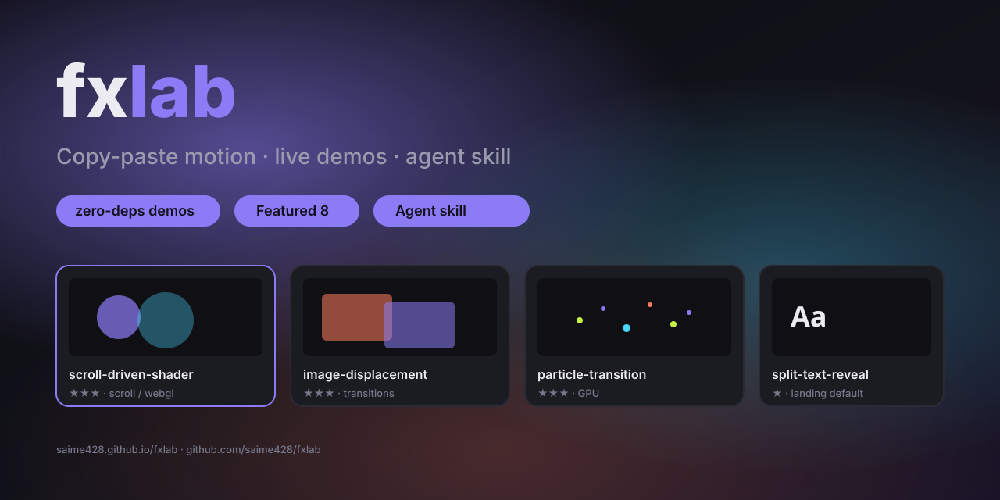

# fxlab 🧪

<p align="center">
  
</p>

> **炫酷可抄 · 零依赖 demo · AI 会选型**  
> 把获奖站级网页动效拆成可复用 pattern：原理 README + 双击能跑的 `demo.html`，并附 AI 选型索引与通用 Agent skill。

[English](README.en.md) · [在线 Demo](https://saime428.github.io/fxlab/) · [样板间 Showcase](https://saime428.github.io/fxlab/showcase/) · [完整索引 INDEX](INDEX.md) · [口味铁律 TASTE](TASTE.md)

```text
Copy-paste web motion patterns with live demos.
Not another CodePen dump — curated patterns, taste rules, agent-ready INDEX.
```

---

## 30 秒上手

| 你是… | 怎么用 |
|--------|--------|
| **前端 / 设计师** | 打开 [Live demos](https://saime428.github.io/fxlab/) → 点卡片全屏试玩 → 读 pattern README 抄结构 |
| **要整页参考** | 打开 [Showcase](https://saime428.github.io/fxlab/showcase/)（多 pattern 拼成的 landing） |
| **任意 Agent** | 安装 skill（见下）→ 说「给这个 landing 加有质感的动效，贴合现有设计」 |

---

## 镇馆 8 式（先看这些）

对外传播与选型时优先这 8 个；其余在下方完整目录。

| Pattern | 一句话 | 难度 | Demo |
|---------|--------|------|------|
| [滚动驱动 Shader](patterns/scroll/scroll-driven-shader/) | 滚动驱动 shader uniform，一眼「贵」 | ★★★ | [demo](https://saime428.github.io/fxlab/patterns/scroll/scroll-driven-shader/demo.html) |
| [Displacement 图片过渡](patterns/transitions/image-displacement/) | 位移图扭曲切换，高冲击作品集感 | ★★★ | [demo](https://saime428.github.io/fxlab/patterns/transitions/image-displacement/demo.html) |
| [GPU 粒子过渡](patterns/transitions/particle-transition/) | 粒子化状态切换，技术向吸睛 | ★★★ | [demo](https://saime428.github.io/fxlab/patterns/transitions/particle-transition/demo.html) |
| [Shader 遮罩擦除](patterns/transitions/shader-wipe/) | 全屏 shader 擦除，章节/路由高级切换 | ★★★ | [demo](https://saime428.github.io/fxlab/patterns/transitions/shader-wipe/demo.html) |
| [Split Text 拆分入场](patterns/text/split-text-reveal/) | 逐行/逐字入场，落地页刚需 | ★ | [demo](https://saime428.github.io/fxlab/patterns/text/split-text-reveal/demo.html) |
| [横向滚动画廊](patterns/scroll/horizontal-gallery/) | sticky + 横移映射，产品叙事常用 | ★★ | [demo](https://saime428.github.io/fxlab/patterns/scroll/horizontal-gallery/demo.html) |
| [View Transitions](patterns/transitions/view-transitions/) | 浏览器原生共享元素过渡 | ★★ | [demo](https://saime428.github.io/fxlab/patterns/transitions/view-transitions/demo.html) |
| [拖拽 + 弹簧回弹](patterns/hover/drag-spring/) | 物理弹簧手感，3 秒 GIF 成立 | ★★ | [demo](https://saime428.github.io/fxlab/patterns/hover/drag-spring/demo.html) |

> 想看「拼装后的完整页」而不是散装效果 → **[Showcase 样板间](https://saime428.github.io/fxlab/showcase/)**

---

## 这和 CodePen / 动画收藏夹有什么不同？

| 常见形态 | fxlab |
|----------|------------|
| 零散 snippet | **有分类、难度、场景、禁忌** 的 pattern 条目 |
| 只有灵感截图 | **可运行 demo** + 原理 + 实现要点 |
| 让 AI 乱加动效 | **INDEX 选型 + TASTE 口味铁律**，默认 2–4 个效果而不是堆 8 个 |
| 教程站绑定某一库 | demo **零依赖可开**；上项目可再换成 GSAP 等 |

---

## 给 Agent 用

`skills/fxlab/` 是一份标准 skill 包（`SKILL.md` + 仓库内 INDEX/TASTE）。**不绑定某一家 Agent**：只要你的工具支持 skill / 规则文件 / 可粘贴系统提示，都可以装。

### 安装（按你的 Agent 选路径）

```bash
# 通用：clone 后把 skills/fxlab 拷到该 Agent 的 skills 目录
# Claude Code 示例
cp -r skills/fxlab ~/.claude/skills/fxlab

# 或 degit（无需整仓）
npx --yes degit saime428/fxlab/skills/fxlab ~/.claude/skills/fxlab
```

Windows (PowerShell，Claude Code 路径示例):

```powershell
Copy-Item -Recurse skills\fxlab $env:USERPROFILE\.claude\skills\fxlab
```

其他 Agent：把同一目录放到其文档要求的 skills / rules 位置；或直接让 Agent 读取仓库根的 `INDEX.md` + `TASTE.md` + `skills/fxlab/SKILL.md`。

### 怎么用

新会话里说：

> 给这个 landing 加有质感的动效，贴合现有设计，不要堆满动画。

Agent 会读：

| 文件 | 用途 |
|------|------|
| [`INDEX.md`](INDEX.md) | 全量 pattern 一览 + 场景套餐 |
| [`TASTE.md`](TASTE.md) | 颜色 / 密度 / 缓动等「用户没说也要遵守」的口味 |
| 各 pattern `README.md` | 原理与实现要点 |
| [`skills/fxlab/SKILL.md`](skills/fxlab/SKILL.md) | 选型流程（新建页 vs 存量站改造） |

远程直读（无本地 clone 时）：

- https://raw.githubusercontent.com/saime428/fxlab/main/INDEX.md  
- https://raw.githubusercontent.com/saime428/fxlab/main/TASTE.md  

---

## 仓库怎么用（人）

两个维度沉淀，互相交叉引用：

- **`cases/` 按网站**：拆解好站用了哪些效果、为什么好看，并链到 pattern  
- **`patterns/` 按效果**：核心资产；每条 = `README.md` + `demo.html`  

工作流：发现好站 → `cases/` 拆解 → 值得复用的抽到 `patterns/` → 双向链接。  
存量站只加动效、不推翻设计：见 skill 里的 **模式 B**，以及 [`retrofits/`](retrofits/)。

### 效果分类

| 分类 | 目录 | 说明 |
|------|------|------|
| 页面切换 | [`patterns/transitions/`](patterns/transitions/) | 路由过渡、View Transitions、遮罩擦除 |
| 滚动动效 | [`patterns/scroll/`](patterns/scroll/) | 滚动驱动、视差、pin/scrub |
| 悬停交互 | [`patterns/hover/`](patterns/hover/) | 磁性按钮、拖拽弹簧、贴纸 |
| 文字动效 | [`patterns/text/`](patterns/text/) | 拆分入场、跑马灯、数字滚动 |
| 3D / WebGL | [`patterns/3d-webgl/`](patterns/3d-webgl/) | Canvas 氛围、粒子、confetti |
| 鼠标跟随 | [`patterns/cursor/`](patterns/cursor/) | 自定义光标、拖尾、手电筒 |
| 加载动画 | [`patterns/loading/`](patterns/loading/) | 序章、氛围音 |
| 布局手法 | [`patterns/layout/`](patterns/layout/) | 粘性堆叠、章节叙事、噪点层 |

判断标准见 [`docs/taxonomy.md`](docs/taxonomy.md)。

---

## 完整 Pattern 目录

| 效果 | 分类 | 难度 | Demo |
|------|------|------|------|
| [滚动渐显 Scroll Reveal](patterns/scroll/scroll-reveal/) | 滚动动效 | ★ | [demo](https://saime428.github.io/fxlab/patterns/scroll/scroll-reveal/demo.html) |
| [横向滚动画廊 Horizontal Gallery](patterns/scroll/horizontal-gallery/) | 滚动动效 | ★★ | [demo](https://saime428.github.io/fxlab/patterns/scroll/horizontal-gallery/demo.html) |
| [Hover 双图切换 Image Swap](patterns/hover/image-swap/) | 悬停交互 | ★ | [demo](https://saime428.github.io/fxlab/patterns/hover/image-swap/demo.html) |
| [SVG 线条绘制 Line Draw](patterns/text/svg-line-draw/) | 文字动效 | ★★ | [demo](https://saime428.github.io/fxlab/patterns/text/svg-line-draw/demo.html) |
| [滚动驱动 Shader](patterns/scroll/scroll-driven-shader/) | 滚动/WebGL | ★★★ | [demo](https://saime428.github.io/fxlab/patterns/scroll/scroll-driven-shader/demo.html) |
| [章节主题突变 Theme Shift](patterns/transitions/theme-shift/) | 页面切换 | ★ | [demo](https://saime428.github.io/fxlab/patterns/transitions/theme-shift/demo.html) |
| [章节式滚动叙事](patterns/layout/section-narrative/) | 布局手法 | ★ | [demo](https://saime428.github.io/fxlab/patterns/layout/section-narrative/demo.html) |
| [氛围音开关](patterns/loading/ambient-sound-toggle/) | 体验层 | ★★ | [demo](https://saime428.github.io/fxlab/patterns/loading/ambient-sound-toggle/demo.html) |
| [Stagger 网格波纹](patterns/text/stagger-grid/) | 编排 | ★ | [demo](https://saime428.github.io/fxlab/patterns/text/stagger-grid/demo.html) |
| [加载序章 Entry Preloader](patterns/loading/entry-preloader/) | 加载动画 | ★★ | [demo](https://saime428.github.io/fxlab/patterns/loading/entry-preloader/demo.html) |
| [打字标题交接 Typed Title Handoff](patterns/loading/typed-title-handoff/) | 加载动画 | ★★ | [demo](https://saime428.github.io/fxlab/patterns/loading/typed-title-handoff/demo.html) |
| [逐行/逐字拆分入场 Split Text](patterns/text/split-text-reveal/) | 文字动效 | ★ | [demo](https://saime428.github.io/fxlab/patterns/text/split-text-reveal/demo.html) |
| [滚动响应字幕 Scroll Marquee](patterns/text/scroll-marquee/) | 文字动效 | ★ | [demo](https://saime428.github.io/fxlab/patterns/text/scroll-marquee/demo.html) |
| [数字滚动 Count Up](patterns/text/count-up/) | 文字动效 | ★ | [demo](https://saime428.github.io/fxlab/patterns/text/count-up/demo.html) |
| [粘性堆叠 Sticky Stack](patterns/layout/sticky-stack/) | 布局手法 | ★ | [demo](https://saime428.github.io/fxlab/patterns/layout/sticky-stack/demo.html) |
| [注释风标题 Comment Heading](patterns/layout/comment-heading/) | 布局手法 | ★ | [demo](https://saime428.github.io/fxlab/patterns/layout/comment-heading/demo.html) |
| [视差漂浮卡片 Parallax Cards](patterns/scroll/parallax-cards/) | 滚动动效 | ★ | [demo](https://saime428.github.io/fxlab/patterns/scroll/parallax-cards/demo.html) |
| [CSS 滚动擦洗 Scroll Scrub](patterns/scroll/css-scroll-scrub/) | 滚动动效 | ★ | [demo](https://saime428.github.io/fxlab/patterns/scroll/css-scroll-scrub/demo.html) |
| [View Transitions 共享元素过渡](patterns/transitions/view-transitions/) | 页面切换 | ★★ | [demo](https://saime428.github.io/fxlab/patterns/transitions/view-transitions/demo.html) |
| [Canvas 氛围背景 Ambient BG](patterns/3d-webgl/canvas-ambient-bg/) | 3D/WebGL | ★★ | [demo](https://saime428.github.io/fxlab/patterns/3d-webgl/canvas-ambient-bg/demo.html) |
| [全屏菜单 Stagger 展开](patterns/transitions/menu-stagger-reveal/) | 页面切换 | ★ | [demo](https://saime428.github.io/fxlab/patterns/transitions/menu-stagger-reveal/demo.html) |
| [Displacement 图片过渡](patterns/transitions/image-displacement/) | 页面切换 | ★★★ | [demo](https://saime428.github.io/fxlab/patterns/transitions/image-displacement/demo.html) |
| [Shader 遮罩擦除过渡](patterns/transitions/shader-wipe/) | 页面切换 | ★★★ | [demo](https://saime428.github.io/fxlab/patterns/transitions/shader-wipe/demo.html) |
| [GPU 粒子过渡](patterns/transitions/particle-transition/) | 页面切换 | ★★★ | [demo](https://saime428.github.io/fxlab/patterns/transitions/particle-transition/demo.html) |
| [可拖拽 + 弹簧回弹](patterns/hover/drag-spring/) | 悬停交互 | ★★ | [demo](https://saime428.github.io/fxlab/patterns/hover/drag-spring/demo.html) |
| [滚动分节锁定](patterns/scroll/scroll-snap-sections/) | 滚动动效 | ★ | [demo](https://saime428.github.io/fxlab/patterns/scroll/scroll-snap-sections/demo.html) |
| [漂浮贴纸物理 Hover](patterns/hover/floating-stickers/) | 悬停交互 | ★★ | [demo](https://saime428.github.io/fxlab/patterns/hover/floating-stickers/demo.html) |
| [覆盖层自动反色 Blend Invert](patterns/layout/blend-invert/) | 布局手法 | ★ | [demo](https://saime428.github.io/fxlab/patterns/layout/blend-invert/demo.html) |
| [区域内隐藏光标 + 跟随标签](patterns/cursor/hide-and-follow/) | 鼠标跟随 | ★★ | [demo](https://saime428.github.io/fxlab/patterns/cursor/hide-and-follow/demo.html) |
| [图片光标 Image Cursor](patterns/cursor/image-cursor/) | 鼠标跟随 | ★ | [demo](https://saime428.github.io/fxlab/patterns/cursor/image-cursor/demo.html) |
| [反色光标点 Blend Dot](patterns/cursor/blend-dot/) | 鼠标跟随 | ★★ | [demo](https://saime428.github.io/fxlab/patterns/cursor/blend-dot/demo.html) |
| [光标拖尾 Cursor Trail](patterns/cursor/cursor-trail/) | 鼠标跟随 | ★★ | [demo](https://saime428.github.io/fxlab/patterns/cursor/cursor-trail/demo.html) |
| [光标手电筒 Spotlight Mask](patterns/cursor/spotlight-mask/) | 鼠标跟随 | ★★ | [demo](https://saime428.github.io/fxlab/patterns/cursor/spotlight-mask/demo.html) |
| [光标跟随预览图 Image Follow](patterns/cursor/image-follow/) | 鼠标跟随 | ★★ | [demo](https://saime428.github.io/fxlab/patterns/cursor/image-follow/demo.html) |
| [噪点颗粒层 Grain Overlay](patterns/layout/grain-overlay/) | 布局手法 | ★ | [demo](https://saime428.github.io/fxlab/patterns/layout/grain-overlay/demo.html) |
| [液态融合 Goo Merge](patterns/hover/goo-merge/) | 悬停交互 | ★★ | [demo](https://saime428.github.io/fxlab/patterns/hover/goo-merge/demo.html) |
| [文字挖空露媒体 Text Mask Media](patterns/text/text-mask-media/) | 文字动效 | ★★ | [demo](https://saime428.github.io/fxlab/patterns/text/text-mask-media/demo.html) |
| [描边字 Outline Type](patterns/text/outline-type/) | 文字动效 | ★ | [demo](https://saime428.github.io/fxlab/patterns/text/outline-type/demo.html) |
| [文字沿路径 Text on Path](patterns/text/text-on-path/) | 文字动效 | ★★ | [demo](https://saime428.github.io/fxlab/patterns/text/text-on-path/demo.html) |
| [卡片翻转 Flip Card](patterns/hover/flip-card/) | 悬停交互 | ★★ | [demo](https://saime428.github.io/fxlab/patterns/hover/flip-card/demo.html) |
| [双色调 Duotone](patterns/layout/duotone-blend/) | 布局手法 | ★★ | [demo](https://saime428.github.io/fxlab/patterns/layout/duotone-blend/demo.html) |
| [像素化过渡 Pixelate](patterns/transitions/pixelate-transition/) | 页面切换 | ★★ | [demo](https://saime428.github.io/fxlab/patterns/transitions/pixelate-transition/demo.html) |
| [形状擦除过渡 Clip Shape Wipe](patterns/transitions/clip-shape-wipe/) | 页面切换 | ★ | [demo](https://saime428.github.io/fxlab/patterns/transitions/clip-shape-wipe/demo.html) |
| [弹性文字入场 Elastic Text](patterns/text/elastic-text/) | 文字动效 | ★ | [demo](https://saime428.github.io/fxlab/patterns/text/elastic-text/demo.html) |
| [纸屑爆发 Confetti Burst](patterns/3d-webgl/confetti-burst/) | 3D/WebGL | ★★ | [demo](https://saime428.github.io/fxlab/patterns/3d-webgl/confetti-burst/demo.html) |
| [旋转渐变描边 Conic Border](patterns/hover/conic-border-spin/) | 悬停交互 | ★ | [demo](https://saime428.github.io/fxlab/patterns/hover/conic-border-spin/demo.html) |
| [精灵图 Hover 预览 Sprite](patterns/hover/sprite-preview/) | 悬停交互 | ★ | [demo](https://saime428.github.io/fxlab/patterns/hover/sprite-preview/demo.html) |
| [假 UI 自演示 Fake UI Demo](patterns/layout/fake-ui-demo/) | 布局手法 | ★★ | [demo](https://saime428.github.io/fxlab/patterns/layout/fake-ui-demo/demo.html) |
| [自定义光标 Custom Cursor](patterns/cursor/custom-cursor/) | 鼠标跟随 | ★★ | [demo](https://saime428.github.io/fxlab/patterns/cursor/custom-cursor/demo.html) |
| [磁性按钮 Magnetic Button](patterns/hover/magnetic-button/) | 悬停交互 | ★★ | [demo](https://saime428.github.io/fxlab/patterns/hover/magnetic-button/demo.html) |

AI 友好的单文件总表（含场景套餐）：[`INDEX.md`](INDEX.md)。

---

## Case 索引

| 网站 | 亮点 | 开源 | 拆解 |
|------|------|------|------|
| [Bruno Simon 2019](https://2019.bruno-simon.com/) | 物理小车探索式导航 | ✅ [源码](https://github.com/brunosimon/folio-2019) | [拆解](cases/bruno-simon-2019/analysis.md) |
| [Igloo Inc.](https://www.igloo.inc/) | 滚动雕刻冰晶,shader 驱动 UI | 官方 case study | [拆解](cases/igloo-inc/analysis.md) |
| [Messenger](https://messenger.abeto.co/) | 5.7MB 多人小星球游戏 | — | [拆解](cases/messenger/analysis.md) |
| [Lando Norris](https://landonorris.com/) | Webflow+Rive+GSAP 拿 SOTM | — | [拆解](cases/lando-norris/analysis.md) |
| [Anime.js](https://animejs.com/) | 文档即演示,stagger 网格 | ✅ [源码](https://github.com/juliangarnier/anime) | [拆解](cases/animejs/analysis.md) |
| [Robin Payot](https://robinpayot.com/) | 滚动=3D 镜头推进 | — | [拆解](cases/robin-payot/analysis.md) |
| [Active Theory](https://activetheory.net/) | 自研引擎全 canvas UI | — | [拆解](cases/active-theory/analysis.md) |
| [Shopify Editions W26](https://www.shopify.com/editions/winter2026) | 发布说明做成滚动叙事 | — | [拆解](cases/shopify-editions-winter-26/analysis.md) |
| [Hashgraph Ventures](https://hashgraphvc.com/) | 章节宣言叙事+氛围音 | — | [拆解](cases/hashgraph-ventures/analysis.md) |
| [infinite imaginations](https://oninross.github.io/infinite-imaginations/) | TweenMax 时代考古 | ✅ [源码](https://github.com/oninross/infinite-imaginations) | [拆解](cases/infinite-imaginations/analysis.md) |
| [MotionPotion](https://motionpotion.co/) | 纯 CSS 交互动效密度天花板,假 UI 自演示 | — | [拆解](cases/motionpotion/analysis.md) |
| [Cuberto](https://cuberto.com/) | 光标状态机、商业原型 | — | [拆解](cases/cuberto/analysis.md) |
| [Dennis Snellenberg](https://dennissnellenberg.com/) | 磁性按钮极致,SOTD「节制」样本 | — | [拆解](cases/dennis-snellenberg/analysis.md) |

---

## 贡献

欢迎 PR 新 pattern、修 demo、补「实战笔记」。流程与模板见 **[CONTRIBUTING.md](CONTRIBUTING.md)**。

- 网站拆解模板：[`docs/templates/case-analysis.md`](docs/templates/case-analysis.md)  
- 效果条目模板：[`docs/templates/pattern.md`](docs/templates/pattern.md)  
- 收录标准：[`docs/criteria.md`](docs/criteria.md)  

传播物料与 social 图：[`docs/promo/`](docs/promo/)。

---

## 收录标准（摘要）

1. 效果条目要说清「为什么好看」（设计意图），不只「怎么做」。  
2. Demo 零依赖、单文件双击可开；确需库时在文档注明版本。  
3. 标注：性能注意点、可访问性（含 `prefers-reduced-motion`）、移动端。  

---

## License

[MIT](LICENSE)

---

<p align="center">
  <a href="https://saime428.github.io/fxlab/">Live demos</a> ·
  <a href="https://saime428.github.io/fxlab/showcase/">Showcase</a> ·
  <a href="https://github.com/saime428/fxlab">GitHub</a>
</p>
